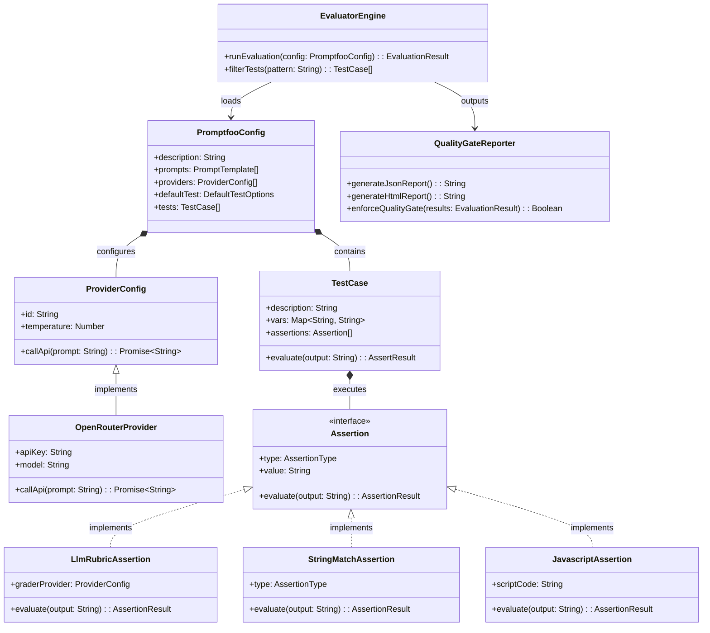

# Promptfoo Class & Component Architecture

This document describes the UML component hierarchy and evaluation workflow for the Promptfoo evaluation engine.

---

## Component & Class UML Diagram

The following Mermaid UML diagram details the core components, provider interfaces, assertion evaluators, and output reporters in the Promptfoo framework.

---

## Class / Component Descriptions

### `EvaluatorEngine`
The central orchestrator responsible for parsing configuration files, rendering variable templates into prompts, dispatching concurrent requests to configured LLM providers, and evaluating assertion rules.

### `PromptfooConfig`
Configuration value object holding parsed representations of prompts, targets, default options, and test suites defined in `promptfooconfig.yml`.

### `OpenRouterProvider`
API client handler implementing provider interfaces to communicate with OpenRouter endpoints (e.g. `openrouter:qwen/qwen3.8-27b:free`), passing parameters such as temperature and authorization headers.

### `Assertion` (Interface) & Concrete Evaluators
- **`LlmRubricAssertion`**: Dispatches the target output alongside a grading prompt to an evaluator LLM (e.g. `openrouter:openai/gpt-4o-mini`) to perform semantic compliance scoring.
- **`StringMatchAssertion`**: Performs string checks like `not-contains` and `not-icontains` to verify prohibited keywords or promises do not appear.
- **`JavascriptAssertion`**: Executes sandbox JS expressions (e.g. `output.length < 800`) to enforce structural or quantitative constraints.

### `QualityGateReporter`
Collects pass/fail assertion outcomes, outputs JSON (`promptfoo-results.json`) and HTML (`promptfoo-report.html`) artifacts, and exits with non-zero code if any test fails to enforce CI quality gates.
