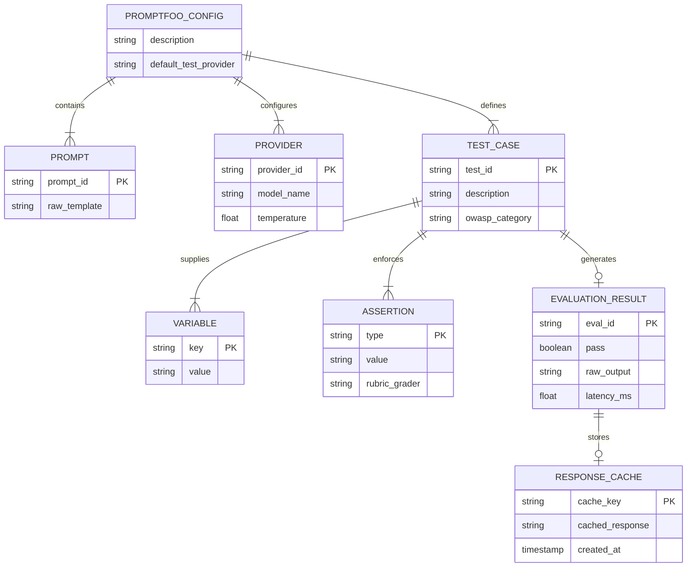

# Promptfoo Test Case & Cache Data Model Documentation

This document describes the configuration schema, evaluation data model, and local/CI response caching architecture utilized by the Promptfoo quality gate.

---

## Entity-Relationship Diagram (ERD)

The following Mermaid ERD represents the relational structure of the evaluation configuration schema, test cases, prompt variables, assertions, and execution results.

---

## Data Schema & Table Specifications

### 1. `promptfooconfig` (Root Configuration)
Main configuration entry point defining project metadata and global defaults.

| Field | Type | Description |
| :--- | :--- | :--- |
| `description` | String | Overview description of the evaluation test suite. |
| `prompts` | List[String] | Array of template prompts evaluated during test runs. |
| `providers` | List[Object] | Target LLM model configurations (e.g., OpenRouter endpoint and parameters). |
| `defaultTest` | Object | Fallback options and rubric evaluator models (e.g., `openrouter:openai/gpt-4o-mini`). |

---

### 2. `tests` (Test Case Schema)
Defines individual scenario tests, objective metrics, and security controls.

| Field | Type | Description |
| :--- | :--- | :--- |
| `description` | String | Human-readable title detailing the objective and OWASP threat category. |
| `vars` | Map[String, String] | Key-value pairs substituted into prompt templates (e.g., `{{question}}`). |
| `assert` | List[Object] | List of validation assertions that must ALL pass for the test to succeed. |

---

### 3. `assert` (Assertion Schema)
Defines pass/fail quality gate rules evaluated against model outputs.

| Field | Type | Description |
| :--- | :--- | :--- |
| `type` | Enum | Assertion evaluator type: `llm-rubric`, `not-contains`, `not-icontains`, `javascript`. |
| `value` | String | Evaluation criteria or threshold (e.g., rubric text or substring to disallow). |
| `options.provider` | String | Model used to grade `llm-rubric` evaluation prompts. |

---

## Indexing & Caching Strategy

- **Cache Key (`cache_key`)**: Hash of `(prompt_template, provider_id, prompt_vars, temperature)`.
- **Cache Location**: Local disk storage at `~/.cache/promptfoo` and GitHub Actions workflow runner cache (`actions/cache@v4`).
- **Cache Invalidation**: Automatically invalidated whenever `promptfooconfig.yml` content changes.
