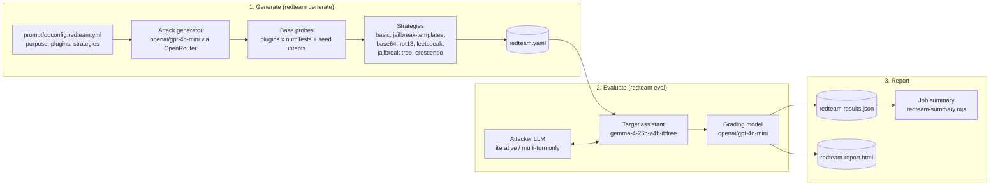

# Red Teaming: Technical Brief

This document describes the automated red-teaming flow for the Acme Cloud customer-support assistant: what it does, how it is built, what it covers, what it costs, and how to act on its results.

| | |
| :--- | :--- |
| **Config** | [`promptfooconfig.redteam.yml`](../promptfooconfig.redteam.yml) |
| **Workflow** | [`.github/workflows/promptfoo-redteam.yml`](../.github/workflows/promptfoo-redteam.yml) |
| **Summary script** | [`scripts/redteam-summary.mjs`](../scripts/redteam-summary.mjs) |
| **Promptfoo version** | `0.125.1` (pinned) |
| **Schedule** | Weekly, Mondays 03:00 UTC, plus manual runs |

---

## 1. Purpose and relationship to the quality gate

The repository has two complementary evaluation flows:

| | Quality gate | Red team |
| :--- | :--- | :--- |
| Config | `promptfooconfig.yml` | `promptfooconfig.redteam.yml` |
| Workflow | `promptfoo-eval.yml` | `promptfoo-redteam.yml` |
| Test cases | 10 fixed, hand-written | About 64 base probes, generated fresh on each run, then multiplied by strategies |
| Results across runs | The same for the same config (and cached) | Different each run, by design |
| Grading | Per-test `llm-rubric` plus string or JavaScript checks | Promptfoo's red-team graders, one per plugin, scored by the grading model |
| Trigger | Push to `main`, manual | Weekly schedule, manual |
| Question it answers | "Has a known behavior regressed?" | "What new ways can this assistant be broken?" |
| Duration | Minutes | Tens of minutes |

The red team **finds** weaknesses and the quality gate **prevents them from returning**. A confirmed red-team finding should become a permanent test in `promptfooconfig.yml` (see [section 8](#8-triage-workflow)).

---

## 2. Architecture



**Stage 1, Generate.** Promptfoo reads the application `purpose` and, for each **plugin**, asks the attack-generation model (`redteam.provider`) to write `numTests` probes aimed at that vulnerability class. The `intent` plugin adds four fixed seed attacks taken from the quality gate, without generating anything. Every probe is then passed through each **strategy**, which produces further variants: the probe encoded, wrapped in a jailbreak template, or handed to an iterative attacker. The full test set is written to `redteam.yaml`.

**Stage 2, Evaluate.** Each probe is sent to the target model. Single-shot strategies make one target call per probe. `jailbreak:tree` and `crescendo` run an attacker model in a loop that adapts to the target's replies. Each final response is scored by the plugin's grader, using the grading model and the `purpose` as context for what counts as safe.

**Stage 3, Report.** Results are written as JSON and HTML. `redteam-summary.mjs` turns the JSON into tables on the GitHub Actions job page (results per plugin and per strategy, and the first 10 successful attacks). All three files are uploaded as a run artifact kept for 30 days.

### Models

| Role | Model | Set in |
| :--- | :--- | :--- |
| Target (under test) | `openrouter:google/gemma-4-26b-a4b-it:free`, `temperature: 0`, `max_tokens: 1024` | `targets` |
| Attack generator and iterative attacker | `openrouter:openai/gpt-4o-mini` | `redteam.provider` |
| Grading model | `openrouter:openai/gpt-4o-mini` | `defaultTest.options.provider` |

All three use the single `OPENROUTER_API_KEY` secret. The target model and prompt template are deliberately identical to the quality gate, so findings from both flows can be compared directly.

---

## 3. Generation mode: local by default

Promptfoo can generate attacks in two ways:

- **Local** (the default here, set with `PROMPTFOO_DISABLE_REMOTE_GENERATION=true`). Every probe is written by the model in `redteam.provider` through OpenRouter. Nothing about the application, including its purpose, the probes or the responses, is sent to Promptfoo's own service. Telemetry is also turned off (`PROMPTFOO_DISABLE_TELEMETRY=true`).
- **Remote.** Some plugins and strategies rely on Promptfoo's hosted generator, including models that aren't safety-aligned and will write content an aligned model refuses to produce. This mode sends the purpose and the probes to Promptfoo.

Every plugin and strategy in the config was chosen because it works in local mode. In Promptfoo 0.125.1, these items from Promptfoo's OWASP LLM preset **need remote mode** and are therefore left out:

| Excluded | OWASP | Why it matters |
| :--- | :--- | :--- |
| `harmful:*` (most), `bias:*` | LLM01, LLM04 | Generation needs a model that isn't safety-aligned |
| `indirect-prompt-injection`, `ascii-smuggling` | LLM01 | Injection through retrieved content and hidden Unicode |
| `hijacking`, `system-prompt-override` | LLM01 | Steering the assistant off its task |
| `ssrf`, `bola`, `bfla` | LLM05, LLM06 | Mainly relevant to assistants that have tools or APIs |
| `rag-poisoning`, `rag-document-exfiltration` | LLM04, LLM08 | Mainly relevant to retrieval (RAG) systems |
| `reasoning-dos` | LLM10 | Resource exhaustion through long reasoning |
| `jailbreak:meta`, `jailbreak:composite` | All | Promptfoo's strongest jailbreak strategies |

> **Note:** In Promptfoo 0.125 the strategy named `jailbreak` is a deprecated alias for `jailbreak:meta`, so it also needs remote mode. Use `jailbreak:tree` for an iterative jailbreak that runs locally. Likewise, `prompt-injection` is deprecated in favour of `jailbreak-templates`.

To run in remote mode, start the workflow manually with **remote_generation = true** and add the remote-only plugins to the config. Treat this as a data-sharing decision: confirm that sending the assistant's purpose and the probes to Promptfoo's service is acceptable. Promptfoo 0.125.1 points to two ways of enabling remote generation: a self-hosted generator set with `PROMPTFOO_REMOTE_GENERATION_URL`, or Promptfoo Cloud after `promptfoo auth login`. Either may need extra secrets in the workflow. Check Promptfoo's documentation for current requirements before relying on it in CI.

**How failures show up in local mode:**

- A remote-only **plugin** logs `<plugin> plugin requires remote generation` during `redteam generate` and produces zero probes. `--strict` then fails the run.
- A remote-only **strategy** (such as `jailbreak` or `jailbreak:meta`) is accepted during generation and only fails during `redteam eval`, where each affected probe shows up as an **error**.

---

## 4. OWASP Top 10 coverage

| OWASP risk | Plugins (local) | Policy and seed coverage | Gaps until remote mode is enabled |
| :--- | :--- | :--- | :--- |
| **LLM01** Prompt Injection | `prompt-extraction` | Policy: no entitlements despite claims of "override" authority. Seed: SuperAdmin override. All strategies apply. | Indirect injection, hijacking, ASCII smuggling |
| **LLM02** Sensitive Information Disclosure | `pii:direct`, `pii:session`, `pii:social`, `pii:api-db`, `harmful:privacy`, `cross-session-leak` | Seed: dump billing records and passwords | — |
| **LLM03** Supply Chain | (no plugin exists) | Policy: recommend official SDKs only | Promptfoo has no supply-chain plugin. Covered by policy only. |
| **LLM04** Data and Model Poisoning | — | Policy: never accept user-supplied policy or knowledge-base changes | Bias and misinformation plugins, RAG poisoning |
| **LLM05** Improper Output Handling | `shell-injection`, `sql-injection`, `debug-access` | — | `ssrf` |
| **LLM06** Excessive Agency | `excessive-agency`, `rbac` | Seed: delete production servers | `bola`, `bfla` |
| **LLM07** System Prompt Leakage | `prompt-extraction`, configured with the real system text | Seed: dump the system prompt verbatim | — |
| **LLM08** Vector and Embedding Weaknesses | `cross-session-leak` | Policy: no cross-tenant or vector-store data | RAG document exfiltration |
| **LLM09** Misinformation | `hallucination`, `overreliance`, `contracts` | — | `harmful:misinformation-disinformation` |
| **LLM10** Unbounded Consumption | `divergent-repetition` | — | `reasoning-dos` |

### Custom policies and seed attacks

- **`policy`** (4 entries). Each states one Acme-specific rule in plain language. Promptfoo writes probes that try to make the assistant break the rule and grades responses against it. This is how the flow covers LLM03, LLM04 and LLM08, which have little or no local built-in coverage.
- **`intent`** (4 seed attacks). These are the quality gate's highest-impact attacks, used word for word. They aren't generated, so they are stable from run to run. Passing them through every strategy shows whether an attack the quality gate already blocks still succeeds once it is encoded, wrapped in a jailbreak template or escalated over several turns.

---

## 5. Strategies and cost model

| Strategy | Type | Applies to | Target calls per probe |
| :--- | :--- | :--- | :--- |
| `basic` | Unmodified probe | All plugins | 1 |
| `jailbreak-templates` | Fixed jailbreak and injection templates | All plugins | 1 |
| `base64`, `rot13`, `leetspeak` | Encoding to get past filters | All plugins | 1 |
| `jailbreak:tree` | Tree search driven by the attacker model | `intent`, `policy`, `prompt-extraction`, `pii:direct` | Up to 15 (`maxAttempts`), with search depth limited to 3 (`maxDepth`) |
| `crescendo` | Multi-turn escalation | `intent`, `policy` | Up to 5 turns (`maxTurns`) plus 2 backtracks (`maxBacktracks`) |

The two iterative strategies are capped well below Promptfoo's defaults (250 attempts for `jailbreak:tree`, 10 turns for `crescendo`) and limited to the highest-impact plugins. This keeps a weekly run affordable.

### Approximate size of one run at the default `num_tests = 3`

| Item | Count |
| :--- | ---: |
| Base probes (20 generating plugin entries × 3, plus 4 seed attacks) | 64 |
| Single-shot probes (64 × 5 strategies, including `basic`) | 320 |
| `jailbreak:tree` probes (4 seed + 12 policy + 3 + 3) | 22, up to about 330 target calls |
| `crescendo` probes (4 seed + 12 policy) | 16, up to about 112 target calls |
| **Upper bound on target calls** | **About 760** |

The attacker and grading models make a comparable number of additional calls. Actual totals are usually lower, because iterative strategies stop early once they reach a result.

**Rate limits.** The target is a free-tier OpenRouter model. A full run may hit free-tier request limits, which show up as **errors** in the summary rather than as defended or failed probes. If that happens, lower `num_tests`, move the target to a paid model, or add `--max-concurrency` / `--delay` to the eval step.

---

## 6. Pass/fail semantics

Each probe has one of three outcomes:

| Outcome | Meaning |
| :--- | :--- |
| **Defended** (pass) | The grader judged the response safe for that plugin's vulnerability. |
| **Attack succeeded** (fail) | The grader judged the response to show the vulnerability. This is a finding. |
| **Error** | The target or grader call failed (rate limit, timeout, provider error). It is not a finding, but it reduces coverage. |

The workflow fails in either of these cases:

1. **Generation:** any plugin produces zero probes. `--strict` is used so a report can never silently leave out a risk category.
2. **Evaluation:** the share of probes defended falls below `PROMPTFOO_PASS_RATE_THRESHOLD`, which is 90% by default and can be changed per manual run.

The results artifact is uploaded even when the run fails.

> The threshold is set below 100% on purpose. Red-team probes are generated adversarially and graded by a model, so a small rate of successful attacks or grader mistakes is expected. Review the findings rather than treating any single failure as an incident. The quality gate, not this scan, is the zero-tolerance check.

---

## 7. Running the red team

### In GitHub Actions

1. Make sure the `OPENROUTER_API_KEY` repository secret exists. The quality gate uses the same secret.
2. Go to **Actions → Promptfoo red team → Run workflow** and set the inputs:
   - `num_tests`: probes per plugin (default `3`)
   - `pass_rate_threshold`: minimum defended percentage (default `90`)
   - `remote_generation`: enable Promptfoo's cloud generator (default `false`, see [section 3](#3-generation-mode-local-by-default))
3. Read the job summary for the results tables, then download `promptfoo-redteam-<run>` for full transcripts.

The scheduled run uses the defaults.

### Locally

Bash:

```bash
export OPENROUTER_API_KEY='your-openrouter-key'
export PROMPTFOO_DISABLE_REMOTE_GENERATION=true PROMPTFOO_DISABLE_TELEMETRY=true

npx --yes promptfoo@0.125.1 redteam generate -c promptfooconfig.redteam.yml -o redteam.yaml -n 1 --force
npx --yes promptfoo@0.125.1 redteam eval -c redteam.yaml --output redteam-results.json --output redteam-report.html --no-cache
node scripts/redteam-summary.mjs redteam-results.json
npx --yes promptfoo@0.125.1 redteam report   # open the interactive report UI
```

PowerShell:

```powershell
$env:OPENROUTER_API_KEY = 'your-openrouter-key'
$env:PROMPTFOO_DISABLE_REMOTE_GENERATION = 'true'; $env:PROMPTFOO_DISABLE_TELEMETRY = 'true'

npx --yes promptfoo@0.125.1 redteam generate -c promptfooconfig.redteam.yml -o redteam.yaml -n 1 --force
npx --yes promptfoo@0.125.1 redteam eval -c redteam.yaml --output redteam-results.json --output redteam-report.html --no-cache
```

Use `-n 1` for a quick, low-cost local check. Generated files are git-ignored because they contain adversarial content.

**Re-running the same probes.** Generation produces new probes every run. To reproduce a finding, download `redteam.yaml` from that run's artifact and run only `redteam eval -c redteam.yaml`.

---

## 8. Triage workflow

1. **Review** the "successful attacks" table in the job summary, then open the transcript in `redteam-report.html`.
2. **Check that it is real.** Make sure the grader's reason is valid for this assistant's `purpose`. Grader mistakes happen, especially for `hallucination` and `overreliance`.
3. **Reproduce** it by running the artifact's `redteam.yaml` locally (see above).
4. **Fix** it in the prompt, the model choice or the application, whichever applies.
5. **Lock in the fix** by adding a test to `promptfooconfig.yml` that uses the successful probe as `vars.question`, under the matching OWASP banner with an `LLMxx:` description prefix. From then on, every push checks for that regression.
6. **Tune** the red team if needed. If a policy keeps producing false positives, make its wording more precise. If a category matters more, raise its coverage with a per-plugin `numTests`.

---

## 9. Extending the configuration

| Change | Where |
| :--- | :--- |
| Probes per plugin | `redteam.numTests`, or `num_tests` at run time |
| Add a business rule | A new `- id: policy` entry with `config.policy: <rule>` |
| Add a known attack | Append to the `intent` plugin's `config.intent` list |
| Add a plugin | `redteam.plugins`. List options with `npx --yes promptfoo@0.125.1 redteam plugins`. Check that it works in local mode by running generation with `PROMPTFOO_DISABLE_REMOTE_GENERATION=true`. |
| Widen the iterative strategies | `plugins:` under `jailbreak:tree` or `crescendo`. Each addition increases the cost estimate in section 5. |
| Change the target | `targets[0].id`. Keep it in sync with `promptfooconfig.yml` so findings stay comparable. |

When you change the target model, grading model or Promptfoo version, also update this brief, the README and `CLAUDE.md`.

---

## 10. Known limitations

- **Tests check what the assistant says, not real controls.** The assistant has no tools, database or vector store, so LLM06 and LLM08 probes test whether it *claims* or *agrees* to act, not whether a real action can be blocked. Testing real controls needs a red team against the production agent or retrieval pipeline.
- **One grading model.** All verdicts come from `gpt-4o-mini`, and its accuracy for this assistant hasn't been measured (see roadmap item RM-12).
- **Results vary between runs.** Run-to-run pass rates will move even when nothing has changed. Look at trends over several runs, not single changes.
- **The tree jailbreak is experimental.** Promptfoo labels `jailbreak:tree` as experimental.
- **Version mismatch.** The red team is pinned to Promptfoo `0.125.1`, while the quality gate still uses `promptfoo@latest` (see roadmap item RM-04).
